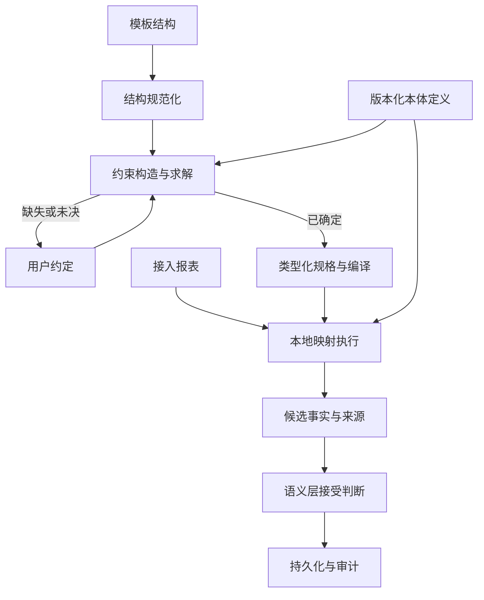

> 历史探索资料，已停止作为实施方案。当前方向为无 LLM 的 Web 人工语义配置；以 [需求与架构](../需求与架构.md) 和 [开发计划](../开发计划.md) 为准。以下原文保留供参考，不表示后续交付要求。

# bi-lite Excel → 语义层映射：模型、求解与架构

> 本文定义新的目标方案，统一数学模型、成立条件与算法设计，不表示这些能力已经实现。当前实现与交付状态仍以现有架构文档和开发计划为准。
> 数学公式使用 LaTeX 源码；算法、接口名称为设计表达，不对应已实现 API。

## 1. 问题与背景

### 1.1 问题定义

bi-lite 的核心场景是将接入报表映射为语义事实，再按模板取数报送。本方案聚焦前半段：给定 Excel 模板、本体语义定义和用户的有限明确约定，构造规格，将源行确定性地映射为语义坐标与值。

原先依赖 LLM 理解模板并生成 YAML，会将不确定性带入执行资产。本方案以程序控制的规格构造和执行消除这种依赖：业务含义由本体及用户约定提供，程序负责检查、求解、编译和执行。

```text
模板结构 + 本体定义 + 用户约定
  → 完备性与绑定检查 → 约束求解 → 规格

接入报表 + 规格 + 冻结的本体定义
  → 确定性映射 → 候选事实 → 语义层接受判断 → 持久化
```

### 1.2 求解目标

目标是**单向确定性**：同一完整求值输入只有一个处理结果，允许不同输入得到相同结果，不要求可逆。

规格构造还须满足业务约定。程序不能通过任意排序或任选候选，把尚未确定的业务选择伪装成确定解。规格文本可以有多种写法，只要它们在约定输入域内具有相同语义。

用户可以承担有限的信息输入，例如指定列的维度、固定主体、期间角色或标签拆分方式。缺少这些信息时，系统返回具体待补项；用户不必手工编写整套模板解析程序。

### 1.3 范围

本方案处理满足显式输入契约的模板。它不承担任意 Excel 的隐含语义恢复，也不依靠业务金额反推含义。

本体坐标、值语义和关系约束由业务建模确定。映射负责产生候选事实；合计、环比、重复坐标和合法组合等接受判断由语义层承担。

窄长表是候选事实的存储形式。维度体系固定后，新增成员不要求改变表结构；新增维度则属于业务模型变更。

## 2. 模型确定与边界条件

### 2.1 符号与本体

| 符号 | 含义 |
|---|---|
| `T` | 模板结构，包括逻辑表、列、表头、类型与来源位置 |
| `W=(u_1,\ldots,u_N)` | 一个实际逻辑表的有限行序列 |
| `O` | 冻结版本的本体及其语义定义 |
| `A` | 用户已经明确的结构与业务约定 |
| `P` | 规格，包括规则、构造表达式及输出策略 |
| `C` | 当前逻辑表的固定求值环境 |
| `n` | 实例化规格的输入列数 |
| `m` | 已确定业务模型的维度数 |
| `K` | 每行候选事实数量的有限上界 |
| `B` | 规格语言的结构大小上界，用于约束构造搜索 |

本体坐标空间为：

`\mathbb{S}=\prod_{i=1}^{m}\mathbb{S}_i`

建模时可以选择 `m`；业务模型确定后，`m` 固定。主体、期间、指标、口径只是一个四维实例。

各维度正交：坐标角色独立，成员按维度标识，相同文本出现在不同维度时不是同一成员。正交不意味着所有成员组合都合法；组合关系由语义层约束。

`O` 包含成员表、别名、生成器、边界，以及成员携带或引用的值语义和关系规则。单位、精度、符号、合法空值等可以蕴含在这些定义中，不必各自成为坐标维度。

规格保存或绑定版本化语义定义。运行时成员实例由定义求值产生，不必作为实例清单重复写入规格。

### 2.2 行输入与环境

`u\in\mathbb{U}^{n}`

`\mathbb{U}=Num(v)\mid Str(s,vocab\_hint)\mid Formula(s)\mid Empty\mid Bool(b)\mid Date(d)`

`n` 对实例化规格固定，`N` 有限但不固定。类型构造器种类有限，不要求字符串或数值的取值集合有限。

`Str` 保留原文与声明的类型提示。规则依据类型结构选择，具体字符串由构造器解释；`vocab_hint` 的来源必须明确，不能依赖隐式猜测。

`C` 从表头、sheet 等按明确规则提取，对当前逻辑表固定。它是求值环境，不是逐行变化的业务参数。坐标来源可以是：

| 来源 | 例子 |
|---|---|
| 行内语义列 | 主体名、指标名、期间文本 |
| 表头或 sheet 环境 | 值列对应的期间、当前 sheet 对应的主体 |
| 固定声明 | 固定主体、固定口径 |
| 显式结构绑定 | 指定列承担某个坐标角色 |

行序不携带隐含语义。同一行在相同环境下求值不受前后行影响。多区块、合并格和位置相关含义须通过用户约定转为显式结构；不同环境的区块分别视作逻辑表。

环境引用是否声明可静态检查；实际文件能否提供该值须在读取时检查。环境提取失败使当前逻辑表失败，不进入行求值。

### 2.3 输出与映射签名

`\mathbb{V}=\mathbb{R}\cup\{Null\}`

`\mathbb{F}=\mathbb{S}\times\mathbb{V}`

一条候选事实是 `m` 个坐标分量和一个值组成的 `(m+1)` 元组。实际数值表示、精度、舍入与范围由语义定义约束。

实际输出数量 `\hat{k}` 满足：

`0\leq\hat{k}\leq K`

`\operatorname{Seq}_{\leq K}(\mathbb{F})=\bigcup_{j=0}^{K}\mathbb{F}^{j}`

映射签名为：

`P,O,C\vdash f:\mathbb{U}^{n}\rightharpoonup\operatorname{Seq}_{\leq K}(\mathbb{F})`

输出保留槽位顺序与重数，不在映射阶段用集合自动去重。不同规则可以有不同数量的输出槽位，只需共同受 `K` 约束。

实际执行返回：

`Result=Success(\operatorname{Seq}_{\leq K}(\mathbb{F}))\sqcup Failure(\mathbb{D})`

`\mathbb{D}` 是结构化诊断域，包括信息缺失、绑定歧义、非法信号、待扩展成员与求值错误。明确省略可以产生空序列，与失败不同。

### 2.4 候选信号与成员解析

为每个维度引入候选信号域 `\mathbb{X}_i`。候选已经具有明确的维度归属，但不保证属于当前成员集。

对规则 `r` 的输出槽位 `t`，每个坐标分量由提取表达式提供：

`e_{r,t,i}(C,u)\in\mathbb{X}_i`

再通过统一入口解析：

`resolve_i(x;O)\in Known(\mathbb{S}_i)\sqcup ExtensionRequest\sqcup Invalid`

“子公司 D”可以是明确的主体候选，即使本体尚未登记它。没有主体来源则无法提取主体候选，属于另一类问题。

构造表达式来自封闭原语：

`Fixed / Lookup / FromContext / FromSheet / Pattern / Split / Concat`

每个维度表达式最终提供一个维度的信号，并完成相应成员解析。拆分片段、组合方式、模式参数和歧义处置必须明确。所有原语及组合须单值且终止。

解析优先级由规格固定，例如：

```text
别名规范化 → 生成器（若有）→ 成员表查表 → 未知成员请求
```

冲突须被拒绝或按明确规则消解。诊断保留维度、来源位置、信号和触发阶段；位置本身不替用户决定应改绑定还是新增成员。

### 2.5 空值、省略与原子性

- 合法 `Null` 是可求出的值，不是失败。
- 合法省略减少 `\hat{k}`，不影响其他合法元组产生；适用条件与求值顺序由规格语言固定。
- 所有声明的事实槽位仍须通过结构完备性检查，不能用省略掩盖没有维度来源的问题。
- 必需维度缺失不能用数值 `Null` 补齐。
- 真正的构造器失败使整行失败，不提交该行部分输出；行原子性不直接规定整批事务策略。

### 2.6 本体扩展与期间生成器

一次求值期间，本体定义及合法成员域冻结。未知成员只能产生请求，批准扩展并形成新版本后重新求值，不在原运行中静默修改成员域。

扩展按维度进行，只处理已明确归属的候选信号。非法信号和绑定错误不能自动转成新成员。

期间是当前约定中唯一允许受约束自动生成成员的维度：

- 格式、年份范围、粒度、财年偏移等为固定定义。
- 合法域是生成器的值域，有限、可枚举、可判定。
- 值域内成员的求值不是扩展事件；`observed` 仅作审计。
- 生成器变化须版本化；其他维度的未知成员默认进入人工批准流程。

### 2.7 映射与语义接受的边界

“营业收入”与“合计”只要都是合法指标成员，在映射阶段地位相同，不因名称自动跳过或改写。

以下规则由 `O` 声明并交给语义层执行：

- 合计与分项的关系。
- 环比等指标应实存还是由其他事实推导。
- 同坐标结果的归一、合并或冲突处置。
- 维度组合是否合法及其他跨行、跨事实约束。

映射成功不保证语义层接受。语义层拒绝候选事实不否定映射的确定性。跨行猜测、模糊匹配、隐式外部查询和静默降级不属于映射语言。

## 3. 完备性分析与单向确定性论证

### 3.1 相对于维度体系的完备性

**每个待产生事实的槽位，都必须覆盖全部必要维度，并具有明确的值来源和输出策略。**

| 条件 | 检验内容 |
|---|---|
| 维度覆盖 | 每个 `(r,t,i)` 都有声明的提取表达式 |
| 绑定确定 | 来源与解释方式明确；多来源组合或一致性规则明确 |
| 值来源明确 | 数值、空值和省略的来源及规则明确 |
| 信号可观察 | 所需信息在 `(C,u)` 或固定声明中可获得 |

这是对固定维度体系的覆盖检验，不是要求输入覆盖本体中的所有成员。结构样表的数值格可以为空；构造时检查来源与规则，执行时检查实际内容。

语义来源完整也不自动保证规格语言有能力表达它；表达充分性须另行检查。

### 3.2 不同失败的区分

| 状态 | 含义 | 处置 |
|---|---|---|
| 信息缺失 | 某个必要维度或值没有来源 | 要求补充信息；实际输入违约则拒绝求值 |
| 绑定歧义 | 来源存在，但角色或组合方式未确定 | 返回具体待确认项 |
| 成员未知 | 维度归属明确，成员尚未登记 | 进入成员扩展流程 |
| 信号非法 | 不满足已声明的维度或值规则 | 返回诊断 |
| 约定冲突 | 各要求不能同时成立 | 返回冲突依据 |
| 表达不足 | 当前受限语言无法表达约定 | 报告语言边界，不判定业务本身不成立 |

信息充分性要求：固定规格和本体后，相同完整观察 `(C,u)` 不能被要求产生不同结果。不可观察的区别应由用户补充到结构或声明中，否则拒绝构造。

### 3.3 求值确定性命题

将 `Eval(P,O,C,u)\Downarrow r` 记作“求值过程得到结果 `r`”。目标包括终止和单值：

`\forall u,\ \exists!r:\ Eval(P,O,C,u)\Downarrow r`

这里允许结果是诊断；成功映射仍是部分函数。相等性指语义结果，不包括时间戳等附属信息。

以下条件足以保证该命题，不宣称它们是充要条件：

| 条件 | 内容 |
|---|---|
| 固定解释 | 规格、本体、环境及解释器语义固定 |
| 规则单值 | 唯一选择规则；无匹配或多重匹配有明确诊断 |
| 原语单值 | 提取、规范化、解析和值解释均单值 |
| 有限求值 | 输入有限，表达式有限，全部原语终止 |
| 结果明确 | 空值、省略、失败、诊断顺序和原子性固定 |

**论证**：叶子表达式读取固定声明或可观察输入，结果单值且终止。每个构造器对已经确定的子结果进行单值、终止的运算，按表达式结构归纳，整个表达式单值且终止。规则选择唯一，槽位数量有限，按固定策略组合得到唯一结果；任何失败按固定诊断策略结束。因此整行求值终止且结果唯一。

该结论允许多对一映射、重复坐标和合法空值，不要求映射可逆，也不保证候选事实通过语义层验收。

### 3.4 规格构造的存在性与语义唯一性

确定性解释一个规格，与从模板构造规格是两个问题。

令 `\mathcal{D}` 为用户约定的完整输入域。在固定 `O` 下，定义规格等价：

`P\equiv_{\mathcal{D}}Q\iff\forall(C,u)\in\mathcal{D},\ Eval(P,O,C,u)=Eval(Q,O,C,u)`

构造目标是：至少存在一个满足约定的规格，而且所有接受的候选规格属于同一语义等价类。表达式写法不同不构成业务多解。

输出比较遵守已固定的槽位顺序、空值、错误和来源契约；不能仅因最终落库数值相同就任意合并不同处理行为。

有限样例输出相同不能证明全输入域等价。等价判定能力取决于具体语言；本方案只要求使用有证明依据的规范化规则，无法证明时保留未决。

### 3.5 结论边界

模型在显式输入约定下形成闭合抽象：信息完备且绑定明确，才进入受约束的确定性映射；未知成员与语义拒绝有各自处理位置。

这一结论不等于任意模板都可表达。静态检查验证结构与声明；实例检查验证当前输入；具体语言与构造算法仍须证明相对于其搜索空间的可靠性及覆盖范围。

## 4. 数学求解过程

### 4.1 将规格构造表示为表达式选择

对规则 `r` 的槽位 `t`，求：

`p_{r,t}=(e_{r,t,1},\ldots,e_{r,t,m},h_{r,t},b_{r,t})`

其中 `e` 是维度构造表达式，`h` 是值解释表达式，`b` 是产生事实、产生空值或省略的策略。待求的是构造方式，不是业务金额或成员实例。

类型规则及槽位结构也须确定；它们可以来自显式模板声明，或作为有界的结构选择一并求解。

### 4.2 有界规格语言

只有 `K` 有界还不够：一个槽位内仍可能无限嵌套 `Concat` 等构造器。定义受限语言：

`\mathcal{G}_B(T,O,A)`

它满足：

- 原语种类有限。
- 完整规格的结构大小不超过 `B`，包括规则、槽位、表达式和策略。
- 静态参数来自有限的声明集合，例如来源引用、显式常量、模板和分隔符。
- 不凭空枚举任意字符串、正则或代码；新增静态参数来自明确约定。
- 不含不受约束的循环、递归或外部执行。

由有限原语、有限静态参数及结构大小上界，可得 `\mathcal{G}_B` 有限。业务数据中的字符串仍可动态读取，不需要预枚举所有主体或指标值。

### 4.3 候选域与约束

为每个选择变量建立有限候选域。例如：

`D_{r,t,i}=\{e\mid e\text{ 类型正确、来源可用且符合已有约定}\}`

值解释、输出策略和未确定的规则结构也有相应候选域。未知成员不会自动删除一个来源明确的表达式。

令 `z=(z_1,\ldots,z_H)` 表示全部选择，构造可判定约束：

`\Phi(z;T,O,A)`

约束包括维度覆盖、类型相容、来源绑定、角色对应、构造器参数、值策略、规则选择和输出上界。业务事实之间的数值关系不进入此阶段。

一个来源可以被多个分量复用，一个分量可以组合多个来源，因此一般问题不是一对一匹配，也不要求来源绑定具有单射性。

若分量完全独立，且各候选域已经满足局部约束：

`Sol=\prod_{j=1}^{H}D_j`

存在耦合时，还须满足联合约束。每个候选域非空，并不保证整体有解。

### 4.4 解集与判定

`Sol_B(T,O,A)=\{P\in\mathcal{G}_B(T,O,A)\mid\Phi(P;T,O,A)\}`

构造目标为：

`Sol_B\neq\varnothing`

`|Sol_B/\equiv_{\mathcal{D}}|=1`

在有限语言内，若 `\Phi` 可判定，穷举候选即可终止并判定规格存在性。这一结论要求候选枚举覆盖整个声明的语言范围。

语义等价性是另一项要求：有限程序候选不意味着对无限输入域的等价判定自动可解。实现采用可靠的规范化规则合并已证明等价的候选，不声称具有任意程序等价判定能力。

`Sol_B=\varnothing` 只证明当前语言及边界内无解。搜索预算耗尽则连这个结论也不能作出，应返回“未完成判定”。

### 4.5 传播、搜索与用户补充

先根据约定传播约束，删除不可能候选；独立且已确定的分量直接组装，剩余耦合部分再搜索。

用户补充约定后，在语言和静态参数集合不变的前提下，解集只会收缩。若用户引入新来源、常量或构造方式，则重新生成受影响的候选域。

算法可将剩余候选的差异转换为有限问题，例如“哪个期间来源绑定到第二个值列”。用户回答应记录为约束及其依据，不直接生成未经检查的自由代码。

无解时返回造成冲突的约定与位置；不要求第一版求出最小冲突集合。

### 4.6 示例

设 `m=4`，维度依次为主体、期间、指标、口径。用户已明确：

| 输入来源 | 角色 |
|---|---|
| A 列 | 主体 |
| B 列 | 期间 |
| C 列 | 指标 |
| D 列 | 单月值 |
| E 列 | 本年累计值 |

此时 `K=2`，可以构造：

```text
slot 1:
  company = Lookup(Row[A], company)
  period  = Lookup(Row[B], period)
  metric  = Lookup(Row[C], metric)
  caliber = Fixed(单月)
  value   = Interpret(Row[D], O, resolved_coordinates)

slot 2:
  company = Lookup(Row[A], company)
  period  = Lookup(Row[B], period)
  metric  = Lookup(Row[C], metric)
  caliber = Fixed(本年累计)
  value   = Interpret(Row[E], O, resolved_coordinates)
```

单位、空值和省略策略须已由语义定义及约定确定。两个槽位可以复用前三个来源；无须枚举主体、期间和指标的笛卡尔积。

主体尚未登记时产生扩展请求；E 列合法空白可按声明省略或产生 `Null`；一月两个口径是否归一为同一事实由语义层判断。

## 5. 算法与架构设计

### 5.1 构造算法

采用“有类型候选生成 → 约束传播 → 有界搜索 → 证明范围内规范化 → 编译”的流程。

```text
Solve(T, O, A, B, budget):
  检查维度体系、来源声明、静态参数和语言边界
  构造有限规则/槽位结构及有类型候选域
  传播约束，删除不可能的候选

  若发现缺失或矛盾:
    返回位置、依据和待补项/冲突项

  在剩余空间内搜索满足全部约束的规格
  对候选应用有依据的规范化，保留等价证明信息

  若预算耗尽:
    返回 Inconclusive
  若已穷尽且无解:
    返回 UnsatisfiableWithinBound
  若剩余语义差异尚未消解或等价性未获证明:
    返回 NeedsClarification

  选择已证明唯一语义类的规范表示
  静态验证并编译
  返回 Resolved
```

寻找第一个解不足以宣布语义唯一。只有排除其他语义选择，或证明所有剩余候选等价，才可返回 `Resolved`。固定搜索顺序可保证结果与诊断可复现，但不替代业务约定。

类型模式应由声明构造，不能只根据样表当前出现的类型推断完整规则。允许空值的值列须显式覆盖 `Num/Empty` 等约定情形；规则交叠返回诊断，不能按出现顺序静默选择。

候选生成按类型过滤并复用公共子表达式。规范化只使用保语义的变换，不能合并尚未确定的来源角色。

### 5.2 运行时算法

```text
EvaluateTable(W, P, O):
  验证并冻结规格、本体与解释器契约
  按声明提取环境 C；失败则结束当前逻辑表

  对每行 u:
    唯一选择类型规则；不匹配或歧义则报告
    按固定顺序计算输出策略、坐标与值
    未知成员形成带来源的扩展请求
    真正失败则撤销该行暂存输出
    成功则产生不超过 K 个候选事实及来源

  将候选事实交给语义层接受判断
  按明确的批次策略处理诊断与持久化
```

运行时可以采用解释器或编译后的执行计划，两者共享同一类型化中间表示及语义契约。不得直接执行 YAML 中的任意代码。

### 5.3 组件职责



| 组件 | 输入与输出 | 职责 |
|---|---|---|
| 结构规范化 | Excel 结构 → 逻辑表与来源描述 | 按明确约定解释区块、表头和位置 |
| 本体服务 | 固定版本定义 → 类型、解析和值语义 | 构造与执行使用相同定义 |
| 候选与约束服务 | 结构、本体、约定 → 有限求解问题 | 类型过滤、候选生成、约束及证据 |
| 求解器 | 求解问题 → 已确定/待澄清/有界无解/未完成 | 传播、搜索、规范化及状态判定 |
| 规格编译器 | 类型化规格 → 可序列化规格与执行计划 | 静态校验、来源绑定、依赖冻结 |
| 映射执行器 | 实际输入、执行计划、本体 → 候选事实或诊断 | 有界单值求值、空值和行原子性 |
| 语义接受层 | 候选事实与业务规则 → 接受/拒绝 | 关系、派生、坐标归一和冲突判断 |

这些是同一进程内的职责划分，不要求新建外部服务。CLI 与 Web 调用共享服务，求解状态与用户约定独立于交互界面保存。

构造阶段读取结构与语义声明，不查询业务金额。报表读取、值解释与事实接受在本地执行。该目标流程本身不依赖 LLM。

### 5.4 规格产物、诊断与回放

规格产物至少绑定：

- 语言与解释器契约版本，本体版本。
- 逻辑表结构、环境提取、类型规则及输出槽位。
- 类型化表达式、值策略和确定的来源关系。
- 用户约定及影响输出的选择依据。

求解记录保存使用的 `B`、候选边界、未决项及判定状态。它们说明构造过程的覆盖范围，不作为运行时重新猜测来源的依据。

诊断至少携带阶段、规则/槽位、维度、来源位置、原因和处置类别。成员未知、信息缺失、约定冲突与搜索未完成不能共用一个模糊错误。

回放须保留原始或等价规范化输入、规格及本体快照，以及解释器版本或兼容契约。哈希用于核验，不能代替输入与定义本身。来源信息作为事实的附属记录保存，不增加业务坐标维度。

### 5.5 复杂度与资源边界

设有限候选生成完成后有 `H` 个选择变量，每个最多 `q` 个候选；直接组合搜索最多检查 `q^H` 个赋值，还需计入每次约束检查的成本。候选生成自身也可能随 `B` 快速增长，不能从 `m` 固定推出整个构造过程为多项式。

充分约定、独立分量及约束传播可以使常见情形退化为候选扫描和直接组装。算法不需要枚举整个 `\prod_i\mathbb{S}_i`。

运行时设规则选择成本上界为 `d`，单个坐标或值表达式求值成本上界为 `c`，忽略单独计算的环境提取及后续语义接受成本，则处理 `N` 行的成本为：

`O(N[d+K(m+1)c])`

实际实现对输入大小、表达式大小、候选数、搜索节点和时间设置上限。有限理论搜索与工程预算是两个概念；达到预算返回未完成，不伪装成无解或自动扩大范围。

### 5.6 实现成立的条件

后续实现须落实三项契约：具体原语及其类型/求值规则、有限候选生成范围、可靠的等价规范化规则。

验证应覆盖一条代表性的完整链路：约定补全与规格构造、未知成员请求及扩展后重跑、空值/省略处理、语义层对同坐标或派生关系的接受判断。样例用于检验实现，不代替全域等价证明。

当前数学结论是：在规定的有限语言及可判定构造约束内，规格存在性可由终止算法求解；对满足求值条件的规格，执行具有单向确定性。业务语义唯一性须由约定与可靠证明消解，业务事实是否接受仍由语义层决定。
